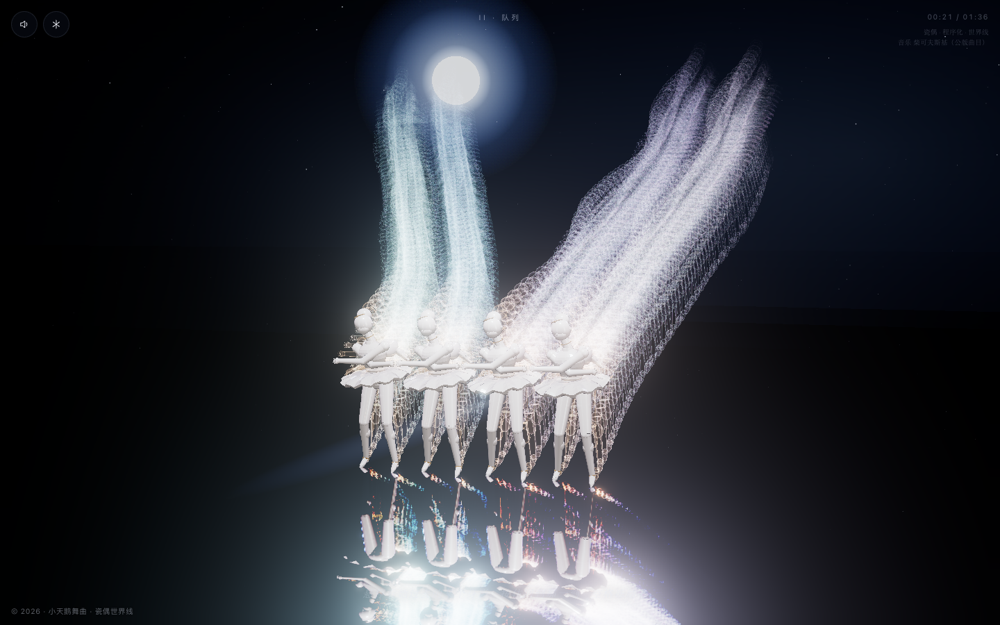
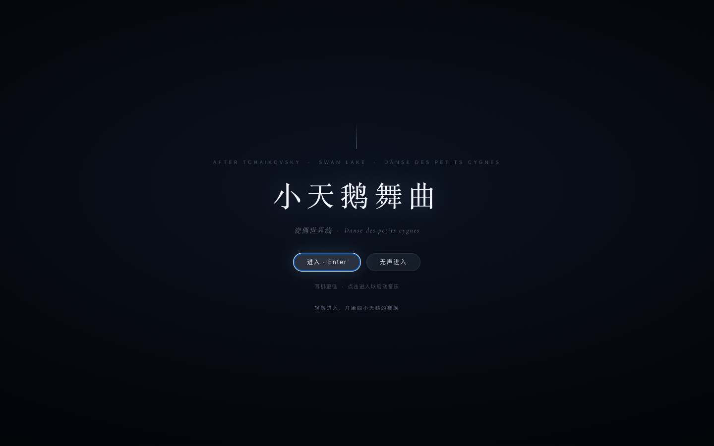
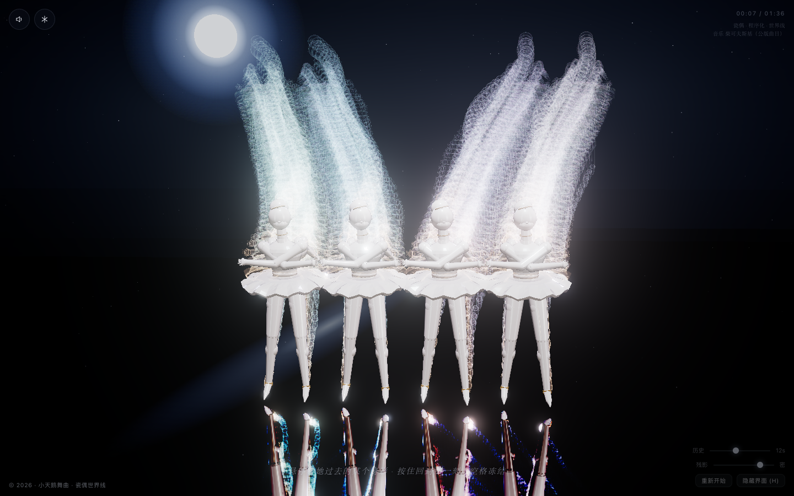
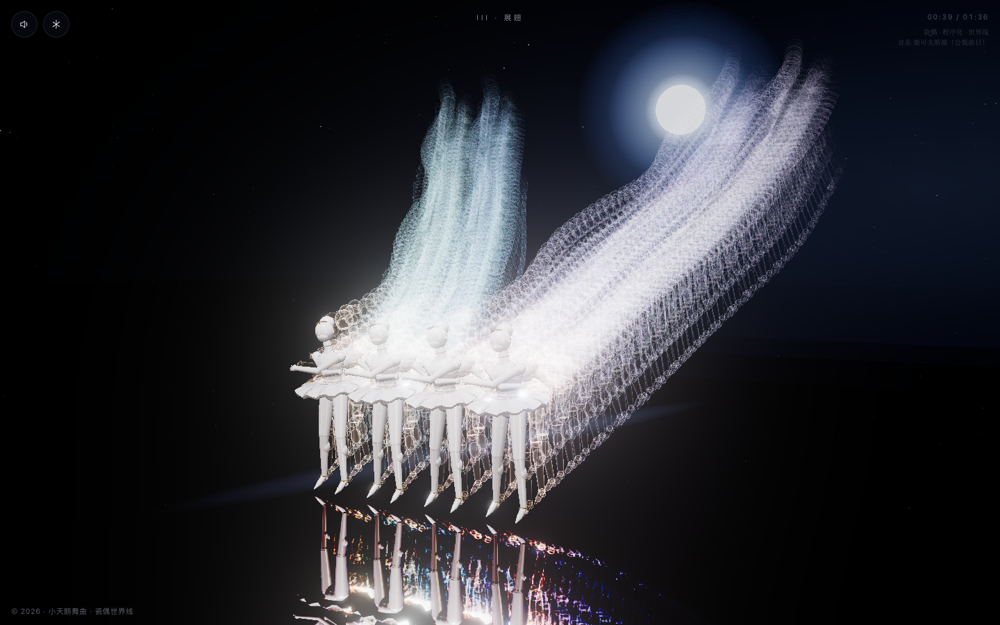
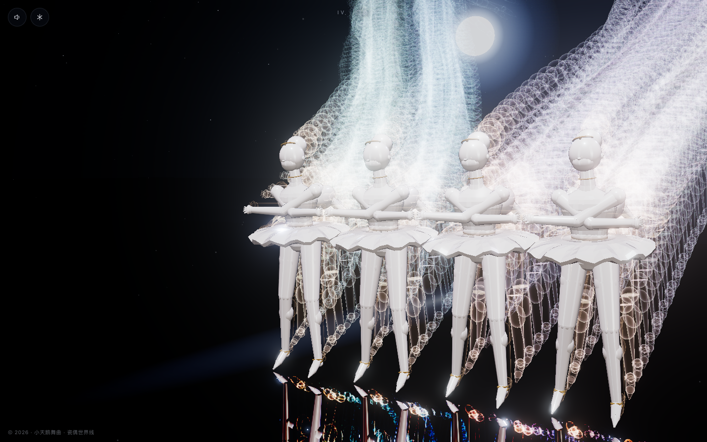
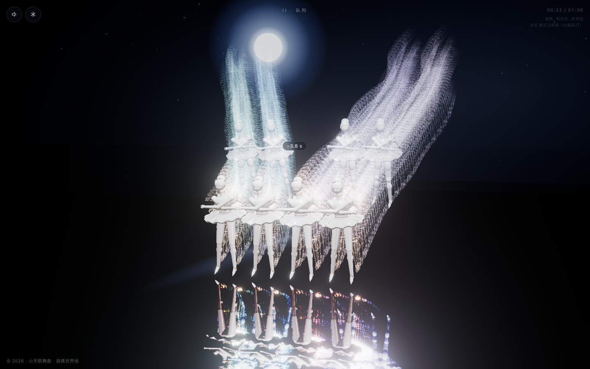
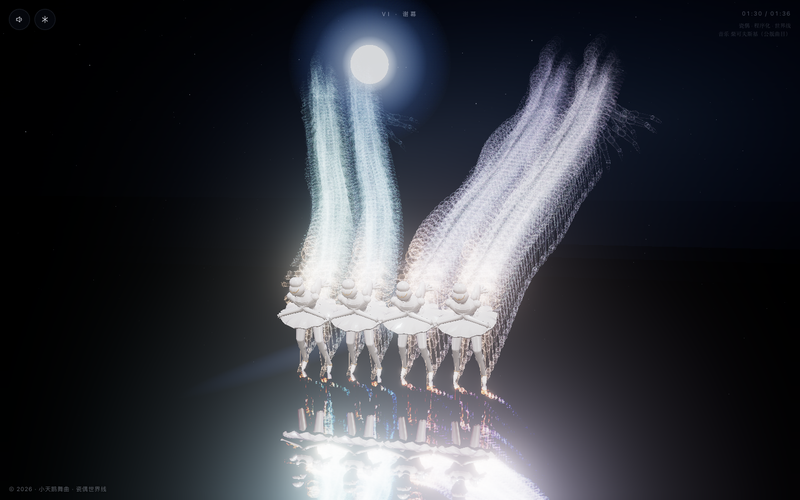
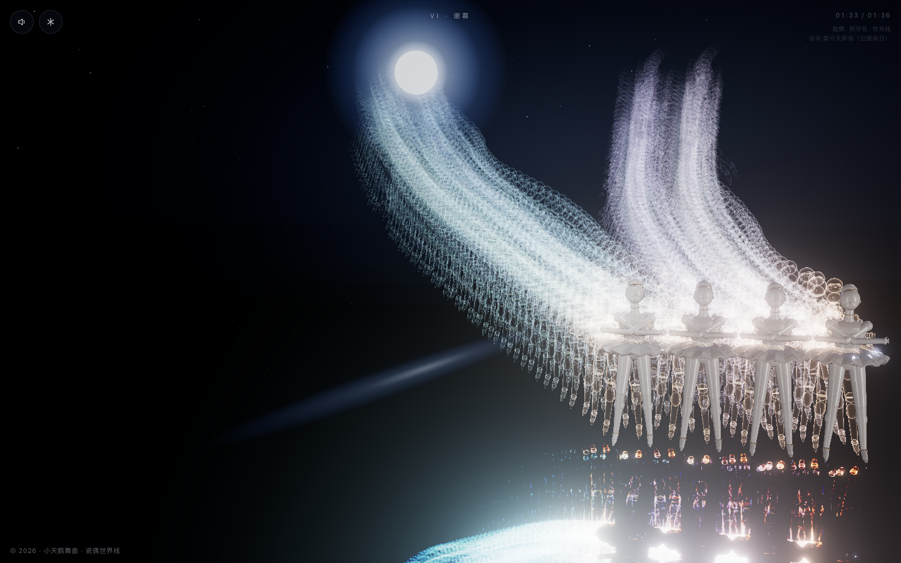
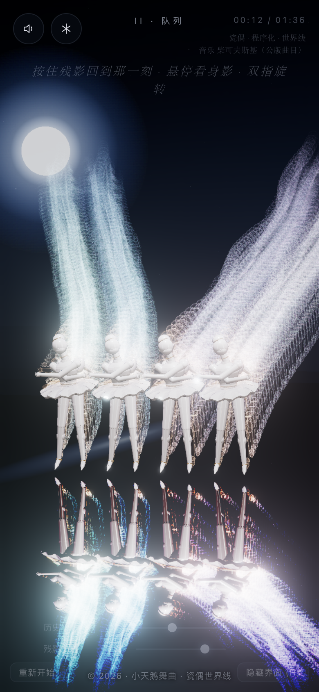

# 小天鹅舞曲 · 瓷偶世界线

> **Danse des petits cygnes · Worldline Cygnets**
> 四只瓷白小天鹅在月夜湖面上起舞。她们停留过的每个姿态，都会在身后冻结成一尊瓷偶，沿四条世界线升起——**时间被做成了可以看见、也可以抓回来的雕塑**。
>
> 机制参考 [Worldline Dancer](https://iamtechartist.com/worldline-dancer/)（历史即雕塑 + 时间旅行）；代码、瓷偶、舞台与编舞实现原创。**配乐取自用户提供的参考演出视频原声**（柴可夫斯基公版曲目），编舞按该视频可见舞汇与音乐节拍重编。



**在线演示**：https://felixlee0608.github.io/little-swans-worldline/ （GitHub Pages；把链接发给任何人就能直接看）

## 状态

**v3 可玩**：17 部件瓷偶骨架（脊柱两段 / 肘部 IK / 贴地屈膝）、四条彩色残影世界线、悬停与抓取过去的姿态、观众掌声里的谢幕。下一版计划见文末。

## 运行

```bash
cd little-swans
node tools/serve.mjs            # → http://127.0.0.1:8782/  (静态服务器；python3 tools/serve.py 也可作为备选)
```

浏览器打开后点 **进入 · Enter**（这一下同时解锁 Web Audio）。作品约 **96.8 秒**一遍：**90.2 秒音乐**（最后半小节收势）+ **观众掌声里的谢幕**（鞠躬 → 起身 → 保持手链退场 → 灯光渐暗，到 96.8s 结束）。音乐一停就进入鞠躬，掌声里不再有任何舞蹈动作；结束后按 `R` 重看。
**完全离线**：three.js 0.185 与所有素材都已本地化（`assets/three/`），不再依赖 CDN。

## 操作

| 操作 | 效果 |
| --- | --- |
| 拖拽 / 滚轮 | 旋转、远近（带阻尼；5s 无操作后镜头缓慢环绕） |
| 悬停残影 / 过去的线 | **那个时刻的身影浮现**：四只天鹅在那个瞬间的整整一组身影（手链仍连着）出现在世界线对应位置，并显示 `−X.X s` |
| **按住残影** | 抓住她的过去：四只一起回到那一刻，雕塑冻结；拖动可沿雕塑滑动选择时刻 |
| 松开 | 回到现在，从选中的时刻继续，音乐续上 |
| `空格` / `F` | 冻结 / 继续（音乐磁带停转） |
| `M` / `H` / `R` | 静音 / 隐藏界面 / 重新开始 |
| 右下角面板 | 历史长度（6–20s）、残影密度（6 档） |

调试参数：`?debug`（暴露 `window.__ls`：`snap/frames/look/perf`）、`?skip`（跳过开场门禁）、`?low`（关 bloom）。

## 五幕（与音乐段落完全对齐）

| 幕 | 音乐段落 | 起点 | 画面 |
| --- | --- | --- | --- |
| i · 入场 | intro | 0s | 黑场、月光、四只瓷偶定格 |
| ii · 队列 | theme | 10.2s | 横排队形开始跳动，身后残影开始积累 |
| iii · 回响 | middle | 30.6s | 四条世界线交织升高；可以抓住残影回溯 |
| iv · 分岔 | reprise | 71.5s | 队列变化、残影密度最大 |
| v · 终幕 | coda | 92s | 长和弦收束 |
| vi · 谢幕 | outro | 89.6s | 掌声起时深鞠躬 → 起身 → 整排退场 → 灯光渐暗 |

## 技术一览

- **three.js 0.185 + 原生 ES Modules**，无构建工具。
- **程序化瓷偶**（`src/swan.js`）：**17 个刚体部件**——骨盆 + 胸/脊柱、头/发髻、双翅、**大臂+小臂两段臂**、**大腿+小腿两段腿**、足尖鞋；暖白瓷 + clearcoat + 微虹彩 + 金饰。脊柱让呼吸、重心和鞠躬有 S 形曲线；手臂用两段 IK 保持手链不断、肘部自然弯；腿用两段正向运动学反推髋高、脚贴湖面。编舞按 104.37bpm 的整曲网格：每拍小跳落地屈膝 plié、侧/后伸腿、横移、头侧；四只肩并肩、双臂在胸前交叉成一条"手链"。
- **世界线**（`src/worldline.js`）：6 控制点向心 Catmull-Rom → 241 原始点 → 160 点等弧长 LUT → 平行传输朝向；四条线按队形左右成扇。
- **残影引擎**（`src/ghosts.js`）：每 0.2s 一次快照（4 只 × 17 部件，锚点相对世界矩阵），环形缓冲 80；**17 个 InstancedMesh** 画出全部历史姿态；年龄淡出 + 新生暖光 + 预乘近似加性 + 由远及近排序；拾取走屏幕投影，不射线遍历实例。**残影带颜色**（参考原视频的蓝色舞台）：四条世界线分别是青、天蓝、蓝紫、淡紫，越老的尾端越偏紫。
- **时间旅行**：抓住残影时 `T` 跳到该时刻、雕塑冻结（用独立的 `frozenSculptureT`），她沿静止的世界线回溯；松手后残影引擎按 T 跳变平移出生时间，雕塑连续不闪。
- **配乐**（`src/music.js`）：**参考演出视频（final 版）原声**，已裁掉开头 0.67s 静音；实测速度 **bpm≈104.37**（拍长 0.5749s，首拍对齐 0.014s），编舞的每一拍都落在这个网格上。音轨里 **90.2s 音乐结束后是观众掌声**（频谱平坦度检测），所以舞蹈在 89.6s 收势、90.2s 起鞠躬，掌声只作为谢幕的背景声。Web Audio 缓冲播放，播放头 = 时间轴 T，冻结时磁带停转、回溯后重新对齐。
- **舞台**（`src/stage.js`）：Reflector 镜面湖 + 半透明水膜 + 月光追光 + 冷轮廓光 + 暖脚光 + 星点/月晕/月光路径 + 浮尘 + 雾；ACES + 轻 bloom + 低调曝光。
- **性能**（无头 Chromium / Apple M2 Max / 1440×900）：`__ls.perf` ≈ **1.0 ms/帧**（渲染吞吐 >600fps）；稳定 60 个残影 / 四只天鹅；**0 console error / 0 pageerror**。

## 目录

```
little-swans/
├── index.html            # 开场门禁 + HUD
├── assets/three/         # 本地化的 three.js 0.185（离线可跑）
├── src/
│   ├── main.js           # 时间轴、渲染管线、相机、抓取回溯
│   ├── stage.js          # 湖面 / 月光 / 追光 / 星尘 / 雾
│   ├── swan.js           # 程序化瓷偶骨架 + 编舞（17 刚体部件）
│   ├── worldline.js      # 世界线曲线（弧长 LUT + 平行传输）
│   ├── ghosts.js         # 残影快照环 + 17 个 InstancedMesh + 彩色瓷影 shader
│   ├── music.js          # 原声播放与时间轴同步（含掌声段）
│   ├── score.js          # 时长 / bpm / 段落（音乐、编舞、HUD 共用）
│   ├── music-data.js     # [旧版] MIDI 合成数据，当前不参与运行时
│   └── ui.js             # 安静 HUD
├── assets/               # three.js 0.185 / HDRI(CC0) / 字体(OFL) / 参考音频
├── tools/                # serve.mjs（静态服务器）、capture.mjs（无头截图，可选）
├── docs/                 # design.md、swan-model.md、ghost-engine.md、music-notes.md、reference-video.md
├── qa/screenshots/       # 本作渲染截图（README 用）
├── CONTRACT.md           # 模块契约（开发用）
├── LICENSE               # MIT（代码）
└── README.md
```

## 参考视频

参考演出视频与抽帧**不随仓库分发**（版权原因，仅作本地分析），因此这里不放对比图；复刻方法、音频来源与节拍分析见 `docs/reference-video.md`。

## 截图

| | |
| --- | --- |
|  |  |
|  |  |



*悬停"过去的线"：那个时刻的整组身影（更亮的瓷偶，手链仍连着）浮现在世界线上，旁边显示 `−3.8 s`。*



*谢幕：音乐一停、观众掌声响起，四人保持手链深鞠躬（HUD 显示 `vi · 谢幕`）。*



*退场：掌声里保持手链向右走几步离场，舞台光渐暗。*



## 版权与来源

- **代码**：MIT，见 `LICENSE`。
- **配乐**：柴可夫斯基《天鹅湖》No.13 IV《四小天鹅舞曲》（公版）；音轨由作者从参考演出视频中提取（剪掉开头静音，90.2s 后是现场掌声）。参考视频原文与抽帧不随仓库分发。
- **HDRI**：Poly Haven 摄影棚 HDRI（CC0）。
- **字体**：Cormorant Garamond（SIL OFL 1.1）。
- 其余模型 / 编舞 / 舞台 / 残影引擎为本项目原创（机制参考 Worldline Dancer，未复用其代码或素材）。

## v3 计划

1. **脸与材质**：目前仍是"素白瓷偶"的留白脸（无五官、关节可见）；可加眼睑/嘴的浅起伏、手指抓握，或换成更接近皮肤的瓷釉。
2. **动作捕捉**：有固定机位素材时，做逐帧追踪并重定向到这套骨架，动作会更贴原视频。
3. **世界线编辑**：Shift 手柄 bend / twist / stretch（拉伸时间 → 回放变慢）。
4. **出片**：用确定性帧渲染 1080p60 / 4K MP4 + 离线混音。

## 部署（GitHub Pages）

- 线上地址：<https://felixlee0608.github.io/little-swans-worldline/>
- 纯静态站点，`main` 分支根目录直接发布（`.nojekyll` 已就位），无需构建；`git push` 后约 1 分钟自动更新。
- 本地预览：`node tools/serve.mjs`；不要用 `file://` 打开（ES module + Web Audio 需要 HTTP）。
